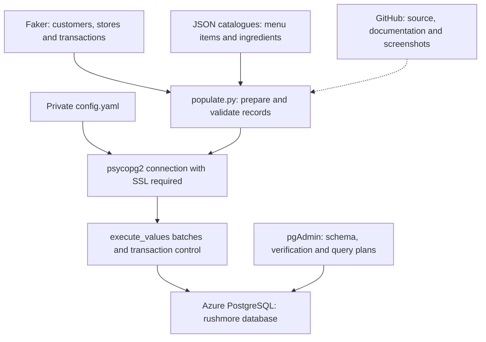
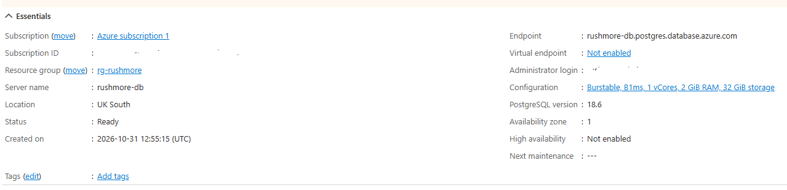
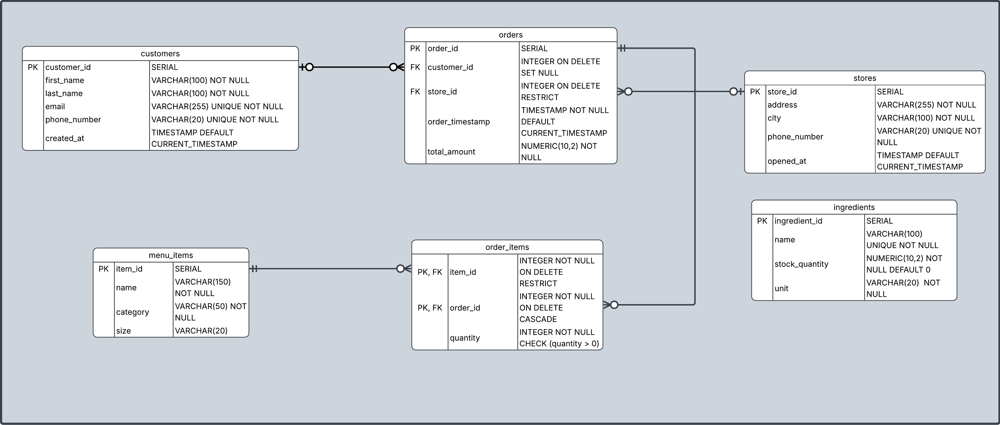
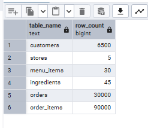
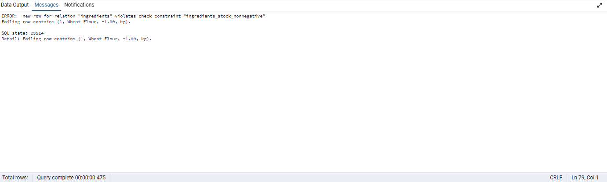
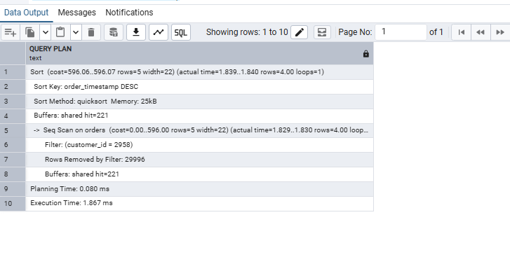
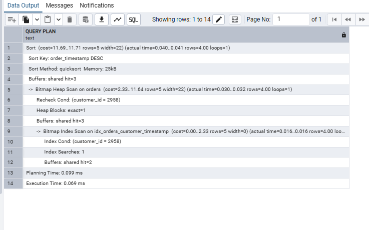
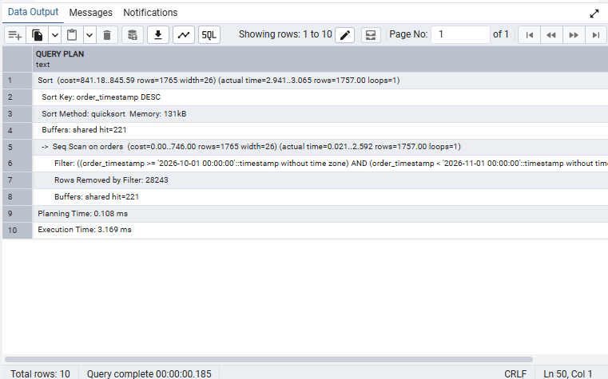
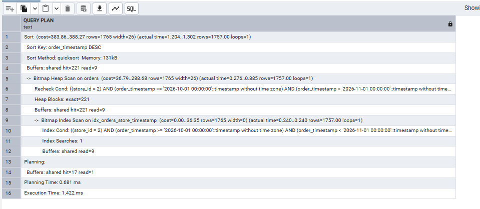

# RushMore Pizzeria | Azure PostgreSQL Capstone

**From a fragile JSON ordering system to a cloud-hosted relational database with validated synthetic data and measured query improvements.**

[](https://www.python.org/)
[](https://faker.readthedocs.io/)
[](https://www.postgresql.org/)
[](https://azure.microsoft.com/)
[](https://www.psycopg.org/docs/)
[](https://www.postgresql.org/docs/current/sql.html)
[](https://www.pgadmin.org/)
[](https://github.com/)


| Dataset loaded | Relational tables | Customer-query improvement | Store-query improvement |
|---:|---:|---:|---:|
| **126,580 rows** | **6** | **96.3% lower median execution time** | **55.1% lower median execution time** |

> A capstone proof of concept using synthetic customer data. Performance results describe the tested queries and environment, not a production service-level guarantee.

## Contents

- [Business problem and objectives](#business-problem-and-objectives)
- [Architecture](#architecture)
- [Database design](#database-design)
- [Population results](#population-results)
- [Repository guide](#repository-guide)
- [How to run](#how-to-run)
- [Data generation and validation](#data-generation-and-validation)
- [Bulk ingestion and reruns](#bulk-ingestion-and-reruns)
- [Database quality and verification](#database-quality-and-verification)
- [Query optimization results](#query-optimization-results)
- [Challenges and lessons learned](#challenges-and-lessons-learned)
- [Limitations and future improvements](#limitations-and-future-improvements)

## Business problem and objectives

RushMore Pizzeria has expanded to multiple locations. Its original `orders.json` storage approach makes shared access, reliable updates and business reporting difficult.

This project demonstrates a relational replacement by:

1. Modelling stores, customers, ingredients, menu items, orders and order lines.
2. Provisioning an Azure Database for PostgreSQL flexible server.
3. Creating the `rushmore` database and deploying the schema.
4. Generating and loading realistic synthetic records without using real customer information.
5. Checking data in Python and enforcing integrity in PostgreSQL.
6. Measuring query plans before and after targeted indexing.
7. Recording the setup, evidence, trade-offs and recovery lessons in this repository.

The implementation is a database proof of concept. A cashier interface and migration of real customer records are outside its current scope.

## Architecture



VS Code is the local development environment. Python generates and loads records; PostgreSQL stores them in Azure. pgAdmin provides a separate connection for schema deployment, inspection and SQL execution. GitHub holds the reproducible project files and evidence, while credentials remain local.

### Cloud deployment



*Azure deployment evidence.*

## Database design

The schema separates business entities and aims for third normal form under the stated business rules. Each entity has its own primary key; order lines resolve the many-to-many relationship between orders and menu items.

| Table | Purpose | Key structure |
|---|---|---|
| `customers` | Synthetic customer identity and registration details | `customer_id`; unique email and phone |
| `stores` | Physical locations and opening dates | `store_id`; unique phone |
| `menu_items` | Fixed product catalogue covering pizzas, drinks, sides and desserts | `item_id` |
| `ingredients` | Ingredient catalogue, measurement units and current stock | `ingredient_id`; unique name |
| `orders` | Customer/store references, timestamps and simulated totals | `order_id`; customer and store foreign keys |
| `order_items` | Menu items and quantities belonging to each order | Composite primary key `(order_id, item_id)`; both columns are foreign keys |

### Entity relationships




### Delete rules

| Foreign key | Rule | Effect |
|---|---|---|
| `orders.customer_id` | `ON DELETE SET NULL` | Retains orders after customer deletion |
| `orders.store_id` | `ON DELETE RESTRICT` | Blocks deletion of a store referenced by orders |
| `order_items.order_id` | `ON DELETE CASCADE` | Removes order lines when their order is deleted |
| `order_items.item_id` | `ON DELETE RESTRICT` | Blocks deletion of a referenced menu item |

## Population results

| Table | Project target | Loaded rows |
|---|---:|---:|
| Customers | 6,000+ | **6,500** |
| Stores | 3–5 | **5** |
| Menu items | 20–30 | **30** |
| Ingredients | 40–50 | **45** |
| Orders | 30,000+ | **30,000** |
| Order items | Approximately 75,000+ | **90,000** |
| **Total** | | **126,580** |

Each order has three distinct menu-item lines, with quantity generated between one and three for each line. The line count is different from the total number of units ordered.



*Actual database row counts captured in pgAdmin. Individual table screenshots and the three runs for each query comparison are retained in `docs/screenshots/`.*

## Repository guide

| File or folder | Role |
|---|---|
| [`populate.py`](populate.py) | Generation, JSON loading, validation, connection management and batched database loading |
| [`schema_creation.sql`](schema_creation.sql) | Six-table schema, keys and relationships |
| [`quality_constraints.sql`](quality_constraints.sql) | Additional checks for non-negative stock and order totals |
| [`verification.sql`](verification.sql) | Constraint inspection, row-count checks and integrity tests |
| [`query_optimization.sql`](query_optimization.sql) | Index inspection, query baselines, index creation and execution-plan comparisons |
| [`requirements.txt`](requirements.txt) | Python dependencies |
| [`data/menu_items.json`](data/menu_items.json) | Fixed menu catalogue |
| [`data/ingredients.json`](data/ingredients.json) | Ingredient names and measurement units |
| [`docs/screenshots/`](docs/screenshots/) | Deployment, population, constraint and performance evidence |
| `config.yaml` | Local connection settings; excluded from Git |

The linked source files contain the complete implementation. This README explains how they work together.

## How to run

### 1. Prerequisites

- Python 3 and Git installed locally.
- VS Code or another Python editor.
- pgAdmin or another PostgreSQL SQL client.
- An Azure PostgreSQL server and a database accessible using your own credentials.
- Network/firewall access from the machine running Python and pgAdmin to that server.

### 2. Obtain the project and prepare Python

Clone this repository using its GitHub **Code** button, then open its root folder in VS Code. In a Windows PowerShell terminal:

```powershell
python -m venv .venv
.\.venv\Scripts\Activate.ps1
python -m pip install -r requirements.txt
```

If the environment is named `venv` instead, use `venv` in the activation path. Select that environment using **Python: Select Interpreter** in VS Code.

The implementation uses `Faker`, `psycopg2-binary` and `PyYAML`. Python includes `json`, `pathlib`, `datetime` and `decimal` in its standard library.

### 3. Configure the database connection

Create `config.yaml` beside `populate.py` using your own values:

```yaml
host: "YOUR_SERVER.postgres.database.azure.com"
user: "YOUR_USERNAME"
database: "rushmore"
password: "YOUR_PASSWORD"
port: 5432
```

The connection function reads these settings using `yaml.safe_load()` and passes them to `psycopg2.connect()`. The implementation uses `sslmode='require'` to require encryption and a ten-second connection timeout. Certificate-verifying SSL configuration is a future hardening step.

Keep these entries in `.gitignore`:

```gitignore
config.yaml
.venv/
venv/
__pycache__/
```

Never commit actual credentials. Adding a previously tracked file to `.gitignore` does not remove it from Git history.

### 4. Deploy the schema to a fresh database

In pgAdmin, connect to your Azure server, select `rushmore` and open **Query Tool**.

1. Open and execute `schema_creation.sql` to create the six tables.
2. Open and execute `quality_constraints.sql` to add the extra non-negative checks.
3. Confirm the tables appear under **Schemas → public → Tables**.

These creation scripts are intended for initial setup. Do not rerun `CREATE TABLE`, `ADD CONSTRAINT` or `CREATE INDEX` statements blindly against objects that already exist. If your schema file already includes an additional constraint, do not add it again through the separate constraint script.

### 5. Populate the database

From the repository root, with the virtual environment active:

```powershell
python populate.py
```

To display and save the output:

```powershell
python populate.py 2>&1 | Tee-Object -FilePath population_run.txt
```

The workflow prepares and validates independent records, connects to PostgreSQL, loads or reuses the parent tables, then prepares orders and order lines using actual saved IDs. Success is reported after the transaction commits, and the connection closes in `finally`.

### 6. Verify the results

Open `verification.sql` in pgAdmin and run its read-only inspection and count queries separately. The expected counts are shown above.

**Run intentional failure and delete tests separately from read-only queries.** Execute `BEGIN` before modifying data, inspect the result in the same Query Tool session, and execute `ROLLBACK` afterwards. If a statement fails, run `ROLLBACK` to clear the failed transaction. Never execute the whole verification file indiscriminately if it includes destructive tests.

### 7. Reproduce the index experiment

In a fresh setup, use `query_optimization.sql` in this order:

1. Inspect existing indexes and update statistics with `ANALYZE public.orders`.
2. Run each baseline `EXPLAIN (ANALYZE, BUFFERS)` query three times.
3. Create the corresponding index once.
4. Rerun the identical query three times with unchanged filters.
5. Compare median execution times and inspect scan types, buffers and sorting.

If the indexes already exist, the original baseline is documented in the saved screenshots. Do not remove useful indexes from the completed database simply to recreate screenshots.

## Data generation and validation

| Entity | Preparation and validation |
|---|---|
| Customers | Faker first/last names, unique emails and phone numbers, current-year registration timestamps; required text, length, uniqueness and date checks |
| Stores | Faker street addresses, cities and unique phones; opening dates between five and two years before execution; required text, length, uniqueness and date checks |
| Menu items | JSON catalogue; 20–30 records, required fields, category membership, text lengths and duplicate name/size checks |
| Ingredients | JSON catalogue plus generated stock; 40–50 records, unique names, required fields, units, finite non-negative quantities, numeric range and precision checks |
| Orders | Actual customer/store IDs; timestamps no earlier than either registration or store opening; foreign-reference, count, date and total checks |
| Order items | Three distinct menu items per order; valid references, positive integer quantities, unique ID pairs and per-order line-count checks |

Phone generation retries values longer than 20 characters. Punctuation and extensions remain acceptable because the database stores phone numbers as text; format standardisation is not claimed.

Stock measured in `units` uses whole numbers between 0 and 500. Weight and volume use generated decimal quantities in an illustrative 0–200 range. `Decimal` values are suitable for `NUMERIC(10,2)` without introducing binary floating-point rounding.

Orders use simulated totals in an illustrative 5–150 range. These totals are independent of order lines because the agreed schema has no menu prices or historical unit-price column.

## Bulk ingestion and reruns

### Why `execute_values()`?

`psycopg2.extras.execute_values()` sends multiple rows in each INSERT statement. With `page_size=1000`, it reduces database round trips compared with issuing one statement per row, which is useful when connecting over a network to Azure.

- Explicit column lists keep dictionary-to-column mappings clear.
- Values are passed through psycopg2 adaptation rather than interpolated into SQL strings.
- `RETURNING` with `fetch=True` collects results across batches.
- Saved IDs are used directly instead of assuming sequences start at 1 or remain gap-free.
- Returned rows carry their identifiers; the workflow does not rely on input/output ordering.
- A connection transaction groups new inserts, committing on success and rolling back new work on failure.

A batch size of 1,000 is a practical starting point, not a benchmark-proven optimum. PostgreSQL `COPY` could be evaluated for larger loads; ingestion throughput was not benchmarked in this project.

### Rerun behaviour

The `reuse_or_load()` helper implements a controlled bootstrap workflow:

| Table state | Action |
|---|---|
| Empty | Insert prepared records |
| Populated with the expected count | Read and reuse saved records |
| Populated with a different count | Raise an error for investigation |

Both prepared records and loaded/reused records are validated. Existing records are not overwritten by newly generated samples printed at the start of a run.

This is **not a general upsert or catalogue synchronisation system**. Matching counts do not establish that database values equal the JSON catalogue. Partial datasets require investigation rather than automatic repair. The approach assumes one population process at a time and fixed target counts.

## Database quality and verification

Python checks support early feedback; database constraints protect writes from every client, including pgAdmin.

| Database mechanism | Protection |
|---|---|
| Primary keys | Unique entity IDs and unique order/item pairs |
| `NOT NULL` | Required values cannot be NULL |
| `UNIQUE` | Customer email/phone, store phone and ingredient-name uniqueness |
| Foreign keys | Valid references and defined deletion behaviour |
| `NUMERIC(10,2)` and text lengths | Numeric precision/scale and bounded text storage |
| `CHECK (quantity > 0)` | Positive order-item quantities |
| `ingredients_stock_nonnegative` | Non-negative stock |
| `orders_total_nonnegative` | Non-negative order totals |

`NOT NULL` does not reject blank strings; Python applies stricter non-blank checks. Allowed categories/units, whole-number stock for countable supplies, cross-table date consistency and three lines per order are also application-level rules in the current implementation. The supplied optional timestamps and nullable order foreign keys remain nullable in SQL.

### Constraint rejection evidence



*The attempted negative stock update is rejected by `ingredients_stock_nonnegative`. This error is the expected outcome of the test.*

Constraint inspection and intentional invalid-write tests are recorded in `verification.sql`. Delete-rule testing covers customer `SET NULL`, store/menu-item `RESTRICT` and order-line `CASCADE` behaviour.

## Query optimization results

Two realistic read patterns were measured using `EXPLAIN (ANALYZE, BUFFERS)` before and after indexing.

```sql
CREATE INDEX idx_orders_customer_timestamp
ON public.orders (customer_id, order_timestamp DESC);

CREATE INDEX idx_orders_store_timestamp
ON public.orders (store_id, order_timestamp DESC);
```

The first supports customer order-history searches; the second supports store/date-range searches. Primary-key and unique-constraint indexes were inspected before adding targeted indexes. Foreign keys do not automatically create indexes on referencing columns.

### Results from three runs per case

| Query | Before times (ms) | After times (ms) | Median before | Median after | Median reduction |
|---|---|---|---:|---:|---:|
| Customer `2958` history | 1.908, 1.835, 1.867 | 0.086, 0.069, 0.066 | **1.867 ms** | **0.069 ms** | **96.3%** |
| Store `2`, October 2026 | 3.192, 3.169, 3.159 | 1.422, 1.350, 1.437 | **3.169 ms** | **1.422 ms** | **55.1%** |

Reduction is calculated as `(median_before - median_after) / median_before × 100`.

These are PostgreSQL server-side execution times, excluding planning and client/network time. Three runs provide a small practical comparison, not a rigorous load test; caching and server conditions affect timing. Baseline and indexed comparisons must use the same query and filters.

### Customer history: 30,000 rows examined to four matches located by index

| Plan observation | Before | After |
|---|---|---|
| Access method | Sequential scan | Bitmap index scan + bitmap heap scan |
| Matching rows | 4 | 4 |
| Rows removed by filter | 29,996 | None reported |
| Top-level execution buffers | 221 shared hits | 3 shared hits on warm runs |
| Separate sort | Yes | Yes |

**Before — representative median run**



**After — representative median run**



### Store history: faster filtering despite visiting the same heap pages

The store/date query returns 1,757 rows. Before indexing it discards 28,243 rows during a sequential scan. After indexing it uses a bitmap scan, but the matching records still occupy all 221 heap pages. Warm execution accesses 230 buffers including nine index pages, compared with 221 before.

The measured improvement therefore coincides with avoiding evaluation of unrelated table rows, **not a reduction in accessed pages**. Both plans retain a separate sort because bitmap scans do not preserve index ordering.

**Before — representative median run**



**After — representative median run**



### Indexing trade-offs and partitioning decision

Indexes consume storage and require maintenance during inserts and updates. Two measured query patterns justified these additions; extra indexes were not added without a demonstrated use case.

Partitioning was deferred: the current data volume and measured performance do not justify its additional operational complexity. It could be reconsidered for substantially larger order history with date-based retention or partition-pruning requirements.

## Challenges and lessons learned

### Customer deletion during constraint testing

During an `ON DELETE SET NULL` test, customer `2958` was deleted without an explicit `BEGIN`. Auto-commit made the deletion permanent, so a subsequent `ROLLBACK` could not reverse it. Orders `1`, `4016`, `4546` and `18542` remained, with their customer reference set to NULL as designed.

Recovery recreated customer `2958` with clearly labelled replacement synthetic details because the original Faker values were unavailable. A registration timestamp earlier than the earliest affected order was used. The four confirmed references were restored inside an explicit transaction, inspected and committed, returning the customer count to 6,500.

This restored relational links, **not the original customer's exact details**. Future modification tests explicitly start a transaction and roll back within the same session. Recovery is documented as an incident, not an instruction to rerun the one-off repair.

### Other implementation lessons

- **Name generation:** indexing `fake.name()` selects characters; `fake.first_name()` and `fake.last_name()` produce the intended fields.
- **Phone lengths:** realistic generated formats may exceed `VARCHAR(20)`; generation retries and validation catch this before insertion.
- **Decimal ranges:** `positive=True` cannot be combined with a zero minimum in the Faker version used; explicit non-negative bounds resolved the error.
- **Python representations:** `Decimal(...)` and `datetime.datetime(...)` are typed values, not unwanted text stored in PostgreSQL.
- **Git privacy:** YAML filenames are not inherently private; explicit ignore rules and avoiding tracked credentials are essential.
- **Reruns:** Faker uniqueness applies to its current instance, not automatically to existing database data. Reusing saved tables prevents blind repeat inserts.
- **Execution plans:** bitmap scans may retain sorting, and faster execution does not always mean fewer page accesses.

## Limitations and future improvements

- Order totals are simulated independently of line quantities. Adding historical unit prices would support reconciled financial totals.
- Ingredients are not linked to recipes or stores. Recipe usage and per-store inventory would require additional modelling.
- Stock ranges are illustrative rather than ingredient-specific; smaller realistic ranges for yeast, herbs and similar supplies would improve realism.
- Phone formatting is varied; a chosen locale and standardised representation would improve consistency.
- The fixed-count rerun approach is not concurrent-safe catalogue synchronisation or a general migration mechanism.
- Dates use naive timestamps as defined in the supplied schema. An explicit timezone strategy would be appropriate for wider deployment.
- Synthetic generation is not source-data masking: no real customer dataset was transformed. Values and dates vary between fresh runs, and Faker calls do not guarantee realistic business distributions.
- The deployment demonstrates the required cloud workflow, not complete production readiness. Access controls, certificate verification, monitoring, backup/restore exercises and broader workload testing remain future work.

## Capstone outcomes

| Project area | Delivered evidence |
|---|---|
| Data modelling | Six-table schema, relationships and Lucidchart ERD |
| Cloud deployment | Azure PostgreSQL instance and pgAdmin connection evidence |
| Synthetic population | 126,580 rows across six tables |
| Ingestion | Batched inserts, actual-ID retrieval and transaction handling |
| Quality | Python validators, SQL constraints and rejection/delete-rule tests |
| Optimization | Two indexed query comparisons with three runs per case |
| Reproducibility | Dependencies, configuration instructions, linked source and saved screenshots |

The project demonstrates an end-to-end database engineering workflow: model, deploy, populate, validate, measure and document.
